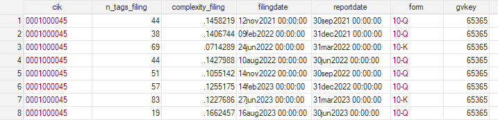
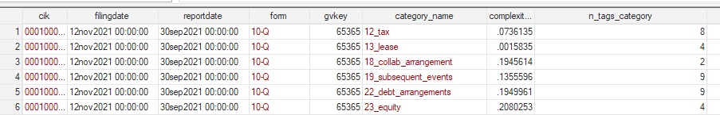

## Companion repository for:

*Bernard et al., (2026). Using GPT to measure business complexity, The Accounting Review, Forthcoming.*

Paper link: [SSRN](https://papers.ssrn.com/sol3/papers.cfm?abstract_id=4480309) - [The Accounting Review](#tbd)

## Table of contents

- **1. Appendix**
    - [SSRN](https://papers.ssrn.com/sol3/papers.cfm?abstract_id=4480309)
- **2. Models**
    - Available on [Hugging Face](https://huggingface.co/Ties/gpt-business-complexity)
    - See the `models` folder for more details and setup instructions. 
- **3. Paper datasets**
    - Available in the `datasets` folder, each are briefly described below.

## Dataset descriptions

**Notes**
- See the paper and its appendix for full details on dataset construction and variable definitions.

**Dataset 1: complexity at the filing level**

Provided at `datasets/complexity_filing.dta`.

**Dataset 2: complexity at the filing+category level**

Provided at `datasets/complexity_filing_category.dta`.

